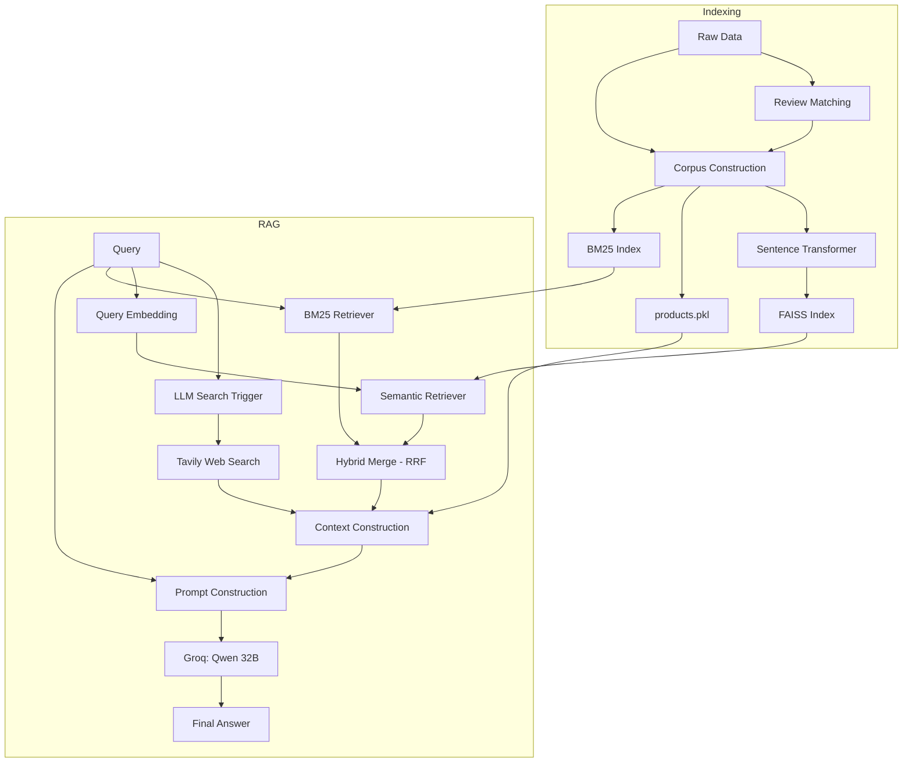

# DSCI 575 Group Project
This App is designed to help musical enthusiasts find the most appropriate suggestions for shopping on Amazon. 

## Dataset Description
This is a large-scale Amazon Reviews dataset collected in 2023 by McAuley Lab, and it includes rich features such as:
- User Reviews (ratings, text, helpfulness votes, etc.)
- Item Metadata (descriptions, price, raw image, etc.)
- Links (user-item / bought together graphs).
Data was retrieved from [here](https://amazon-reviews-2023.github.io/). 

## Data Processing / Model Workflow

1. Data Acquisition (milestone1_exploration.ipynb)

Raw data is streamed directly from the Amazon Reviews 2023 dataset (Musical Instruments category) using DuckDB — no full download required. This yields two sources: product metadata and user reviews.

2. Filtering & Cleaning (notebook → data/processed/)

- Reviews are filtered to keep only: Ratings > 3/5, verified purchases, and review text between 50–300 words for higher quality output.
- Reviews and Metadata files are converted to parquet files and then downsampled to allow upload to Github repo. 
  
3. Index Building (utils.py)

Run utils.py to build both search indexes from the filtered parquets:

- Corpus construction: For each product, title + features + description + top-3 most helpful reviews are concatenated into a single text document.
- Semantic index (FAISS): The corpus is encoded with all-MiniLM-L6-v2 (SentenceTransformers) and stored in a FAISS vector store (data/processed/faiss_index/).
- BM25 index: Each product's title, features, and description are lowercased, stripped of punctuation, stopword-filtered, and stemmed (Snowball), then indexed with BM25Okapi and pickled to data/processed/bm25_index.pkl.
- Products are also saved as products.pkl for retrieval at query time.

4. Search (bm25.py / semantic.py)

Both scripts load their respective indexes and accept a --query and --k argument:
- bm25.py tokenizes the query identically to the index and returns the top-k products by BM25 score (higher = better).
- semantic.py embeds the query with all-MiniLM-L6-v2 and returns top-k products by FAISS cosine similarity (lower score = better, as FAISS returns L2 distance on normalized vectors).

>*Some design choices: Semantic search included the reviews as part of the corpus but not BM25 because with basic keyword matching including the review might skew the model too much. We sorted the reviews by helpful_vote and only kept the good reviews (rating \>= 3).*

## Getting Started

1. Clone the repo to your local device
```bash
git clone git@github.com:UBC-MDS/DSCI_575_project_tyin98_danieljy.git
cd DSCI_575_project_tyin98_danieljy
```
2. Create the environment to run the app
```bash
conda env create -f environment.yml
conda activate dsci575_td
```
3. Setup the index for running the models. Depending on your RAM, this could take a few minutes. You can increase the speed by reducing the number after '--max-products'. 

**More Efficient Index Building**
```bash
python src/utils2.py --rebuild --max-products 10000
```

**Default Index Building**
```bash
python src/utils.py --rebuild --max-products 5000
```

1. The RAG pipeline requires a Groq API key and a Tavily API key for web search capabilities. Add them to your .env file:
```text
GROQ_API_KEY=your_groq_key
TAVILY_API_KEY=your_tavily_key
```

1. Run the Streamlit App locally. Click on the URL within the terminal if the window does not open automatically. 
```bash
streamlit run app/app.py
```

1. Within the app, select whether you want the BM25 or Semantic Search model for regular search or the RAG tab for LLM assisted search. Then, type your query in the search-bar.

## Cloud Deployment (Posit Connect Cloud)
The cloud deployment uses **pre-built indexes** that are committed to the repository: `data/processed/products.pkl`, `data/processed/bm25_index.pkl` and `data/processed/faiss_index/` (10,000 products, about 51 MB). The app loads them at startup, so it is ready in seconds. Building the indexes on the cloud host instead was too slow (about 16 minutes on its CPU) and ran out of memory.

You can still build the indexes yourself locally, for example to change the number of products:
```bash
python src/utils2.py --rebuild --max-products 10000
```
If you rebuild, commit the updated `products.pkl`, `bm25_index.pkl` and `faiss_index/` before redeploying. If those files are ever missing, the app falls back to building them at startup from the committed parquet files (see `src/artifacts.py`), which needs more memory and takes several minutes.

To deploy:
1. In Posit Connect Cloud, publish from GitHub, pick this repository and branch, and set the primary file to `app/app.py`.
1. Choose **Python 3.11** (dependencies are installed from `requirements.txt` automatically).
1. Add `GROQ_API_KEY` and `TAVILY_API_KEY` as secret variables.
1. If the app is stopped for running out of memory, raise the memory limit in the content's settings.

## Web Search Tool Call
The RAG pipeline have web search capability via Tavily. The pipeline uses the LLM to determine if a query requires web information. If triggered, the web results are combined with the other data for a better answer.

## RAG Pipeline Workflow



## Authors
- Daniel Yorke
- Tiantong Yin 

## Additional Notes
From your terminal within the project root:
-   You can run `python src/semantic.py -q "<your search query>" -k 10` to perform a test search of top 10 matching products using semantic search.
-   You can run `python src/bm25.py -q "<your search query>" -k 10` to perform a test search of top 10 matching products using BM25 search.
